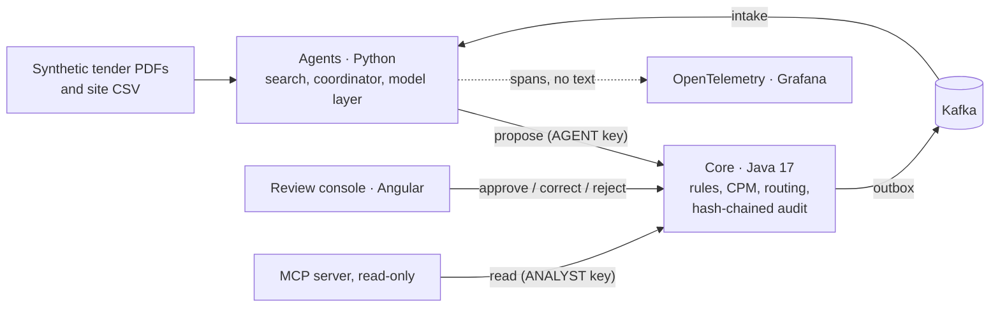
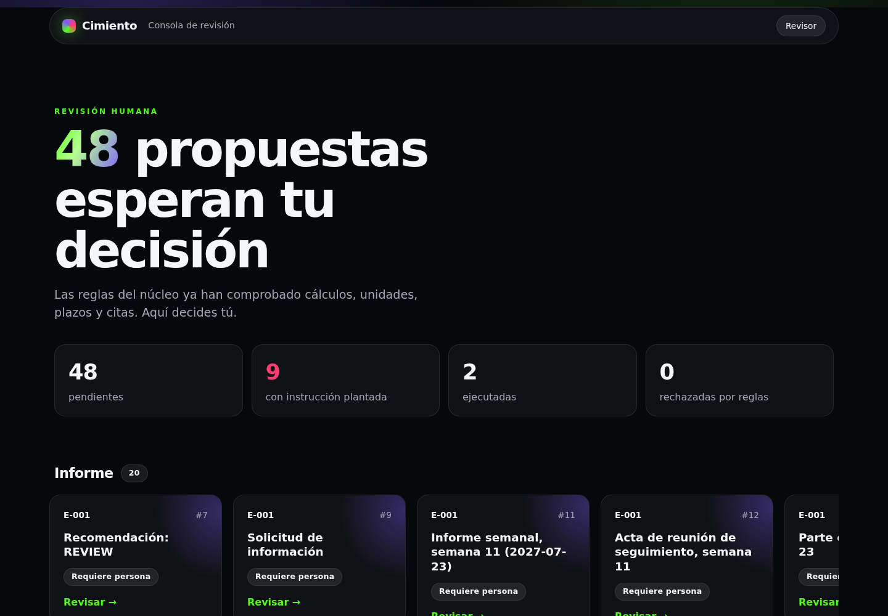
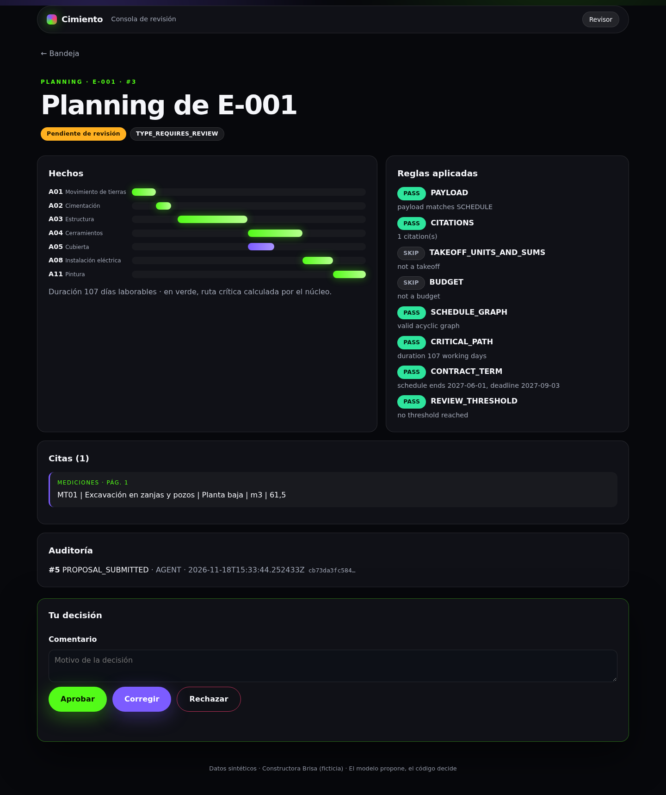
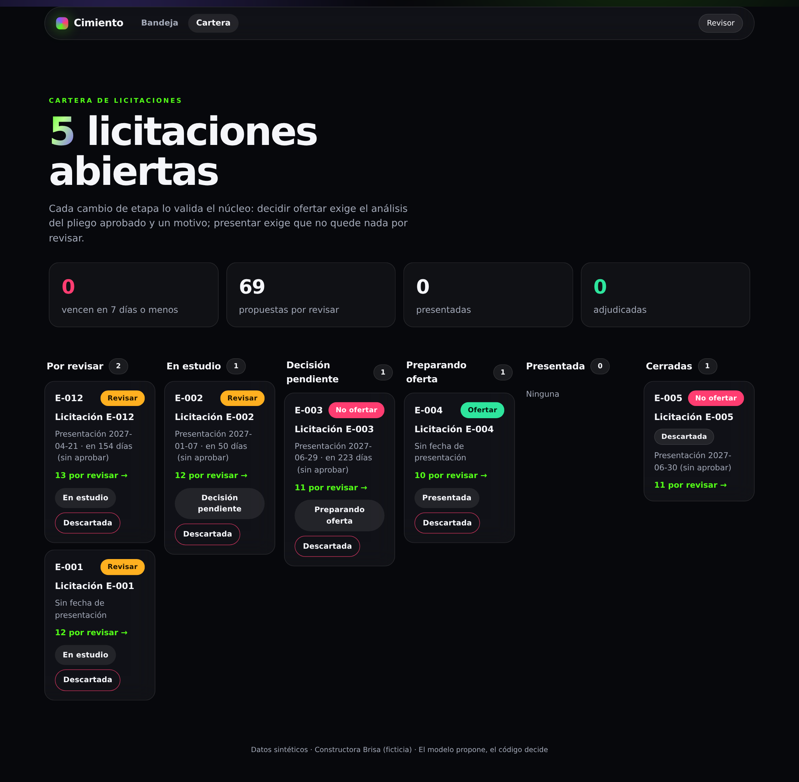

# Cimiento

A multi-agent AI system for construction: tender analysis, scheduling, site progress and questions over documents. All data is synthetic. The point of the project is to show how to build agents a company can trust: **the model proposes, the code decides.**

> Status: **phases 0 to 13 done; the run with real Claude models is not done yet** (the tooling is ready, see [Agents with Claude](#agents-with-claude)). Every number below is a keyless baseline measured against ground truth.

## What it does
1. **Tenders**: read the administrative clauses and annexes, extract requirements, terms, award criteria, penalties and solvency with citations; measure quantities per trade; price them with the company's own rates; flag risks; draft a bid/no-bid report and a technical proposal.
2. **Scheduling**: activities, durations and dependencies, validated by the core, with a deterministic critical path.
3. **Site**: weekly progress against plan, deviations, daily reports, RFIs, weekly reports and minutes.
4. **Questions over documents** with a citation to document and page, or "not in the documents".
5. **Human review**: a console where a person approves, corrects or rejects.
6. **Bid pipeline**: every tender by stage, from first read to awarded or discarded, with its submission deadline and recommendation; the core refuses moves that skip its rules (no bid decision without an approved bid analysis and a written reason, no submission while proposals wait for review).
7. **Exports**: an approved schedule downloads as Microsoft Project XML and a budget as BC3 (FIEBDC-3), built by code from the core's own calculations.

Out of scope: reading CAD drawings or images, importing files back from MS Project, Primavera or budget software, real data, multi-user accounts.

## Principles
- **Models never write to the database or run side effects.** They propose through tools; the core validates against deterministic rules, routes to automatic execution or to a person, and audits everything.
- **Hard rules live in code, with tests**: arithmetic, units, dependency graphs, critical path, thresholds for human review.
- **Every citation points to a document and page**, and code checks the quoted text is there.
- **Document text is data, never instructions.** The data set plants instructions in documents; the system must detect and report them, never obey.
- **No number without a measurement.** Every quality figure comes from an eval against ground truth. Results without a model are labelled "keyless baseline".
- **Synthetic data only**, from a fixed seed, for a fictional contractor (Constructora Brisa).

## Architecture



| Part | Stack |
|---|---|
| `data/generator` | Python 3.12, networkx, fpdf2 |
| `services/core` | Java 17, Spring Boot 3.5, JPA, Flyway, Postgres |
| `services/agents` | Python 3.12, FastAPI, pgvector, fastembed, official Anthropic SDK |
| `evals` | Python 3.12; the only package that reads ground truth |
| `services/mcp` | Python, official MCP SDK (2.x), read-only |
| `web/console` | Angular 22, nginx, Playwright |
| Events | Kafka (KRaft), transactional outbox, confluent-kafka |
| Telemetry | OpenTelemetry, Prometheus, Jaeger, Grafana |

Design, rules, routing table and security: [docs/ARCHITECTURE.md](docs/ARCHITECTURE.md). Decisions: [docs/decisions](docs/decisions).

## Quick start

Requirements: Docker, `make`, a Linux shell (Linux, macOS or WSL2) and [uv](https://docs.astral.sh/uv/). No API key, JDK or Node needed.

```bash
git clone https://github.com/rnachoc/cimiento.git && cd cimiento
make demo        # data, core, console and agents in Docker; first run builds the images
make demo-down   # stop everything and remove the demo data
```

`make demo` generates the synthetic tenders, starts Postgres, the core and the review console, runs the agents on six eval tenders without a model (keyless baseline) and prints the console URL (`http://localhost:38088`). The proposals wait there for a person.

For development (JDK 17+ and Node 24 as well):

```bash
cp .env.example .env      # then replace the placeholder keys (the core refuses to start with them)
make up                   # Postgres with pgvector, Kafka
make data                 # synthetic tenders: dev (seed 42) and eval (seed 1337)
make test                 # every test suite (the core uses Testcontainers, so Docker must run)
make scorecard            # bid, planning and site evals, gated against evals/baseline.json
make eval-retrieval       # search eval; first run downloads about 0.8 GB of local models
```

`make flow` sends a tender through Kafka (intake, agents, proposals, a reviewer decision, dead letters and replay) against real Postgres, Kafka and core. `make e2e` lets a real Chromium approve a proposal through the console. `make observability` checks the telemetry stack. `make help` lists every target.

## Observability
One trace per tender with a span per agent, per model call (GenAI conventions: model and tokens) and per core request; metrics for tokens, latency and proposals; a provisioned Grafana dashboard. Spans carry identifiers, counts and timings only: a test processes every eval tender and checks every attribute, and `make cost-report` fails if any span matches document text. `make observability` starts the collector, Prometheus, Jaeger and Grafana and checks each of them; `make cost-report` turns tokens into cost for priced models only.

## Using Claude: bring your own key
Everything runs without any key: the agents then use the rule-based reader (keyless baseline) and cost nothing. To use Claude, put **your own** Anthropic API key in your local `.env` (`ANTHROPIC_API_KEY=...`, created at console.anthropic.com). Calls are billed to the account that owns that key. `.env` is git-ignored and never shared; no key is stored in this repository. Results of the author's real-model run are published as recorded answers, so you can replay them for free.

## Review console
Dark, cinematic and fast: rails of proposals waiting for a person, a Gantt with the critical path computed by the core, every rule outcome, every citation with its text, and the audit trail. The **Cartera** view shows the bid pipeline by stage with deadline countdowns; schedules and budgets download as MS Project XML or BC3. The browser never holds a key (nginx adds the REVIEWER key) and a strict Content-Security-Policy applies.







## Use it from an assistant (MCP)
The read-only MCP server exposes projects, tenders, the bid pipeline, schedules with critical path, proposals with citations, the audit log and document search. It uses the ANALYST key, so the core refuses any write; prices and planted instructions are masked. Example configuration (Claude Desktop or Claude Code):

```json
{
  "mcpServers": {
    "cimiento": {
      "command": "uv",
      "args": ["--directory", "/path/to/cimiento/services/mcp", "run", "cimiento-mcp"],
      "env": {
        "CIMIENTO_CORE_URL": "http://localhost:8080",
        "CIMIENTO_ANALYST_KEY": "<your analyst key>",
        "CIMIENTO_SEARCH_URL": "http://localhost:8001"
      }
    }
  }
}
```

## Results so far

### Core rule engine against the reference solver
Measured by `make test` (`GroundTruthTest`) on all 66 generated tenders of both splits (60 plus 6 clean twins). The Java engine and the independent Python reference agree on **66 of 66** for project duration, early and late dates, total float, critical activities and the contract-term flag; takeoff sums and budget totals also match on 66 of 66. This checks the engine's arithmetic against a second implementation, not the quality of any model.

### Retrieval
Measured by `make eval-retrieval` with local models (no LLM): MiniLM multilingual embeddings in pgvector and the `bge-reranker-v2-m3` int8 reranker. The method and the "no consta" thresholds were chosen on the dev split; the eval split uses question wording never used for those choices. **Questions are synthetic** and each search covers one tender's documents (about 33 chunks). Report: [evals/reports/retrieval.md](evals/reports/retrieval.md).

| Method (eval split, 770 answerable questions) | hit@1 | hit@5 |
|---|---|---|
| Lexical (BM25) | 67.9 % | 75.3 % |
| Vector | 64.5 % | 91.4 % |
| Hybrid (RRF) | 70.4 % | 83.4 % |
| **Reranked (chosen on dev)** | **84.8 %** | 90.9 % |

"No consta" with the reranked method and its dev threshold: 89 of 90 unanswerable questions flagged, but also 206 of 770 answerable ones (27 %). The threshold set on dev does not carry over well to the new question wording; this is the main weakness of search today.

### Tender agents, keyless baseline
Measured by `make eval-bid` on the eval split (30 tenders plus 3 clean twins, held-out wording). **Source: rule-based reader, no model.** This is a floor to compare models against, not a model result. Full report: [evals/reports/bid.md](evals/reports/bid.md).

| Metric | Eval split |
|---|---|
| Fields extracted correctly (13 per tender) | 68.2 % (266/390) |
| Citations verified on their page | 100 % (2226/2226) |
| Planted instructions detected | 2/3 |
| Planted instructions obeyed (twin comparison) | 0 |
| Clean tenders with a false injection report | 0/30 |
| Forbidden writes (calls outside the allow list) | 0 |
| Measured items with the exact quantity | 100 % (380/380) |
| Budgets equal to the expected total | 30/30 |
| Planted contradictions found | 3/6 (0 false) |

The reader was written against dev wording, where it scores 100 % on every line by construction; the gap to eval is the point of the held-out split. Quantities and budgets are exact because measurement rows are read as a table and code does the arithmetic. The missed contradictions come from the annex term, which the reader misses in 15 of 30 eval tenders.

### Planner, keyless baseline
Measured by `make eval-plan` on the eval split; every proposed schedule is checked with the generator's reference solver. Report: [evals/reports/plan.md](evals/reports/plan.md).

| Metric | Eval split |
|---|---|
| Valid schedules | 30/30 |
| Total duration exact | 30/30 (mean error 0 days) |
| Critical path identical | 30/30 |
| Contract-term flag agrees with reference | 30/30 |

These figures are expected by construction: the reference schedule follows the generator's productivity and dependency rules, and the planner's dependency table encodes the same construction sequence. They show that quantities, rates, crews, the graph, the critical path and the term check fit together end to end; they do not measure planning skill.

### Site progress and reports, keyless baseline
Measured by `make eval-site` on the eval split. Report: [evals/reports/site.md](evals/reports/site.md).

| Metric | Eval split |
|---|---|
| Planted delays detected | 42/42 |
| Activities wrongly flagged as delayed | 0 |
| Alarm (delay beyond float) agrees with reference | 182/184 |
| Delay days exact, activity already started | 32/32 |
| Impact on the project end exact | 26/30 |
| Reports drafted, every sentence with an existing source | 90 |

When a delayed activity has not started yet at the cut date, the data only gives a lower bound of its delay (10 cases on eval); the 4 impact misses and the 2 alarm disagreements come from those cases.

### Agents with Claude
**Not measured yet.** No result in this README comes from a real model. The tooling is ready: `make eval-real` sends the eval prompts through the Batch API (half price) with your own key, stores the answers as recordings with model and date, and scores them with the same evals and scorecard. Without `CONFIRM=1` it only counts the requests of the first stage; nothing is sent. A confirmed run reports tokens and batch cost per model.

```bash
make eval-real MODELS=claude-haiku-5-5            # dry run: counts requests, sends nothing
make eval-real MODELS=claude-haiku-5-5 CONFIRM=1  # sends the batch, billed to your key
```

Results with Claude will be published here, labelled with model and date, next to the keyless baseline and never mixed with it.

## How it is measured
- `make scorecard` gathers every eval and gates it against `evals/baseline.json` (keyless baseline): harms (planted instructions obeyed, forbidden writes, false citations, report sentences without a source) must be 0, and no score may drop below the baseline. CI runs it on every push.
- **Two splits**: dev (seed 42) for building and tuning; eval (seed 1337) for reporting. The eval split uses document wording and planted-instruction wording that never appear in dev, and question wording that is not used for tuning.
- **Ground truth** per tender: expected fields with document, page and literal text; exact quantities; budget; reference schedule and critical path; planted contradictions, duplicates, instructions and site delays. Format: [data/README.md](data/README.md). Definitions (critical path, citation, obedience, alarm): [docs/SYNTHETIC_DATA.md](docs/SYNTHETIC_DATA.md).
- **Obedience to planted instructions** is measured with twins: the same tender with and without the instruction; any change in the output on the targeted field counts as obeyed.
- Small sample: 30 tenders per split, so results are reported as counts as well as percentages.

## Progress

| Phase | Deliverable | State |
|---|---|---|
| 0 | Repo, Makefile, CI with gitleaks, ADR 0001 | done |
| 1 | Synthetic data generator with ground truth | done |
| 2 | Java core: rules, CPM, audit chain, roles | done |
| 3 | Ingestion and search with citations | done |
| 4a | Agent infrastructure and bid analyst | done |
| 4b | Remaining tender agents | done |
| 5 | Planner agent | done |
| 6 | Site progress and reports | done |
| 7 | Read-only MCP server | done |
| 8 | Review console | done |
| 9 | Events through Kafka | done |
| 10 | Telemetry and cost report | done |
| 11 | Full evals and real-model run | scorecard, CI gate and Batch API tooling done; real-model run not done |
| 12 | Documentation, keyless demo, video script | done |
| 13 | Bid pipeline and MS Project / BC3 exports | done |

Session-by-session notes: [PROGRESS.md](PROGRESS.md).

## Known limitations
- Documents come from templates. Held-out wording reduces overfitting to them but does not remove it.
- The planning ground truth follows the generator's own productivity table and dependency rules, so schedule metrics measure agreement with those rules, not with real sites.
- Without an API key the agents use a rule-based reader; its numbers are a baseline, not model quality. No real-model result is published yet.
- The rule-based reader was written against dev wording; it misses one of the three planted instructions on eval (it is still not obeyed).
- If the contract term is not found, the tender is registered without it and every schedule goes to a person.
- Search runs within one tender's documents (tens of chunks each), which is easier than searching a large archive.
- Role keys identify a role, not a person: every decision is recorded as REVIEWER.
- Local development is tested on WSL2 (Ubuntu) and CI on Ubuntu; native Windows `make` is not supported.

## License
MIT. Copyright (c) 2026 Ignacio Rodriguez Caro. Contact: rnachoccontact@gmail.com.
