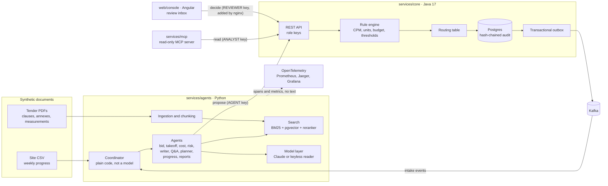
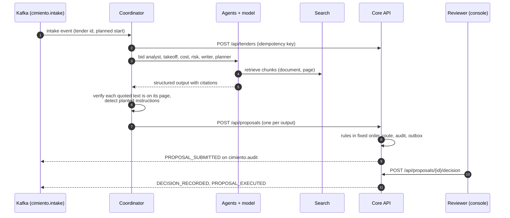
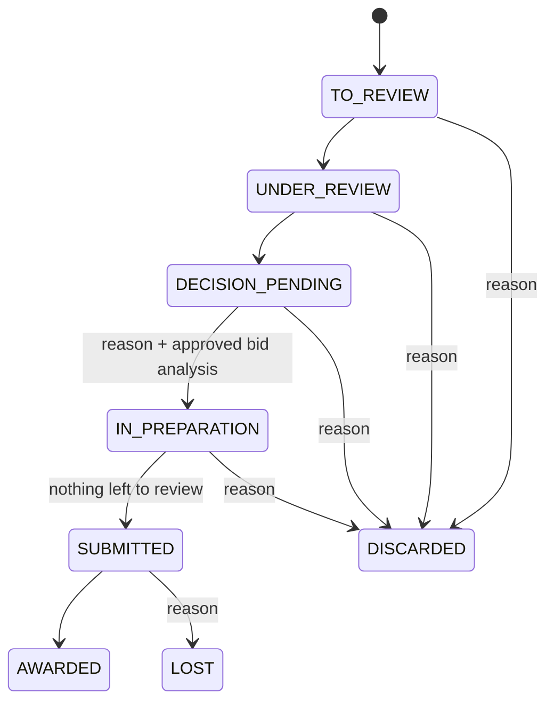

# Architecture

Cimiento splits the work in two: agents read documents and **propose**; a deterministic core **decides**. Models never write to the database and never run side effects. Every proposal is checked by rules in code, routed to automatic execution or to a person, and written to a hash-chained audit log.

## Components

| Component | Path | Role |
|---|---|---|
| Data generator | `data/generator` | Tenders, site data and ground truth from a seed. dev split seed 42, eval split seed 1337. |
| Core | `services/core` | Source of truth: projects, tenders, proposals, decisions, audit. Rules, CPM and routing live here. |
| Agents | `services/agents` | Ingestion, search (`POST /search`), coordinator, agents, model layer, Kafka consumers, telemetry. Talks to the core only through its API with the AGENT key. |
| Evals | `evals` | The only package that reads ground truth. Retrieval, bid, plan, site, cost, scorecard and real-model runs. |
| MCP server | `services/mcp` | Read-only tools for an assistant, ANALYST key, prices and planted instructions masked. |
| Review console | `web/console` | Inbox of proposals waiting for a person (approve, correct or reject), the bid pipeline and file downloads. nginx holds the REVIEWER key. |
| Local stack | `deploy` | Docker Compose: Postgres with pgvector, Kafka (KRaft), core, console, and an optional observability profile. |

## Life of a tender

The coordinator is code. It decides which agents run and in what order; a model never chooses the next step. Each agent returns a Pydantic object. Arithmetic (sums, unit conversions, budget, schedule dates, critical path, bid/no-bid recommendation) is done by code, never by the model.

## Agents

| Agent | Model does | Code does |
|---|---|---|
| Bid analyst | Extract requirements, terms, award criteria, penalties, solvency, each with a quote | Checks the quote is on the cited page; detects planted instructions |
| Takeoff | Reads measurement rows | Sums, converts units, marks duplicates |
| Cost estimator | Picks a company rate per item | Computes amounts and total; the core recomputes them |
| Risk analyst | Points at contradictions and abusive clauses with evidence | Re-checks the evidence |
| Proposal writer | Drafts the technical proposal | Always routed to a person |
| Planner | Activities and dependencies | Durations from quantities and crews; the core validates the graph and computes CPM |
| Progress | Reads the weekly site CSV | Deviations, impact on the critical path, alarms beyond float |
| Reports | Daily report, RFI, weekly report, minutes | Every sentence must cite a source record (`check_sources`) |
| Q&A | Answers with document and page | Says "not in the documents" when retrieval has no support |
| Bid/no-bid | Writes the report | Recommendation comes from explicit rules |

Each agent has an allow list of core calls (`core_client.ALLOWED`): `POST /api/tenders`, `POST /api/proposals` and `GET`. Anything else raises before the request leaves the process, and the eval counts it as a forbidden write.

## Core rules

Applied to every proposal, always in this order. Any FAIL blocks execution; a WARN sends the proposal to a person.

1. `PAYLOAD`: the payload parses into the type's schema; unknown fields are rejected.
2. `CITATIONS`: at least one citation, each with document, page and text.
3. `TAKEOFF_UNITS_AND_SUMS`: known units, conversions to the item's unit, sums of non-duplicate rows.
4. `BUDGET`: amount = quantity x company price, in cents, half up; the claimed total must match.
5. `SCHEDULE_GRAPH`: positive durations, known activities, no duplicates, no cycles.
6. `CRITICAL_PATH`: deterministic CPM on a working-day calendar.
7. `CONTRACT_TERM`: schedule end against the contract deadline (WARN when exceeded or unknown).
8. `REVIEW_THRESHOLD`: amount, risk and injection signals that force review.

## Routing table

| Proposal type | Default route |
|---|---|
| TAKEOFF, BUDGET, SCHEDULE, BID_ANALYSIS, DOCUMENT_DRAFT, REPORT | person |
| RISK_SIGNAL, PROGRESS_UPDATE | automatic, unless any rule warns or a threshold applies |

A detected planted instruction always forces review. The table lives in `ProposalType.java` and is covered by `RuleEngineTest`.

## Bid pipeline

Every tender has a stage. Moves are checked by `rules/Pipeline.java` and made only by a REVIEWER:

`GET /api/portfolio` shows each tender with its stage, the submission deadline from the latest bid analysis (marked when not yet approved), the bid/no-bid recommendation and the proposals waiting for review. Each move is audited; the written reason is kept in `tender_stage_change`, outside the audit chain.

## Exports

`GET /api/proposals/{id}/export` turns a schedule into Microsoft Project XML (MSPDI) and a budget into FIEBDC-3 (BC3). Both files are built by code from the core's CPM and the company rates, never by a model. Failed or rejected proposals cannot be exported; a pending one is named as a draft.

## Audit and events

- Audit rows are append-only (database triggers reject UPDATE and DELETE) and each row stores the hash of the previous one. `GET /api/audit/verify` recomputes the chain.
- Writes carry an idempotency key, so a retried request or a redelivered event creates nothing new.
- Each audit row also writes an outbox row in the same transaction. A publisher sends them to `cimiento.audit`, keyed by project, in audit order.
- Consumers retry with backoff, then send the message to a `.dlq` topic with the error in a header; dead letters can be replayed.

## Security

- **Roles by key**: AGENT can register tenders and submit proposals; ANALYST only reads; REVIEWER decides and moves tenders through the pipeline. Keys come from the environment; the core refuses to start with the placeholder values.
- **Document text is data.** The eval split plants instructions in documents. The detector reports them and the proposal goes to a person. Obedience is measured with twin tenders (same tender with and without the instruction). The detector's patterns are built from the dev split only.
- **No document text in telemetry.** Span and log attributes accept identifiers, counts and timings; a test checks every attribute of every eval tender, and `make cost-report` fails if a span matches document text.
- **The console never holds a key.** nginx adds the REVIEWER key server side and sets a strict Content-Security-Policy with a nonce per request.
- **Secrets**: `.env` is git-ignored, `.env.example` holds placeholders, gitleaks runs in pre-commit and on the full history in CI.

## Search

Documents are split into one chunk per clause (or chapter) and page. Retrieval combines BM25 and multilingual MiniLM embeddings in pgvector with reciprocal rank fusion, then a multilingual reranker (`bge-reranker-v2-m3`, int8). The method and the "not in the documents" threshold were chosen on the dev split. Models run locally through fastembed; no external search service.

## Model layer

- **Keyless** (default): a rule-based reader written against dev wording, or recorded answers when they exist. Its results are labelled "keyless baseline".
- **Claude**: the official Anthropic SDK with structured output (JSON schema). Used only when `ANTHROPIC_API_KEY` is set in the user's own `.env`. Each user pays for their own calls.
- **Batch API**: `make eval-real` sends the eval prompts as batches (half price), stores the answers as recordings with model and date, and scores them with the same evals. Without `CONFIRM=1` it only counts requests and estimates cost.

## Observability

One trace per tender (`cimiento.tender`) with a span per agent, per model call (GenAI semantic conventions: model, input and output tokens) and per core request. Metrics: token usage, model latency, proposals by type. The `observability` compose profile runs an OpenTelemetry Collector, Prometheus, Jaeger and Grafana with a provisioned dashboard.

## Decisions

| ADR | Topic |
|---|---|
| [0001](decisions/0001-initial-decisions.md) | Initial decisions: stack, repository layout, keyless mode |
| [0002](decisions/0002-synthetic-data.md) | Synthetic data generator |
| [0003](decisions/0003-core-service.md) | Core service: rules, routing, audit, roles |
| [0004](decisions/0004-search.md) | Ingestion and search |
| [0005](decisions/0005-agent-infrastructure.md) | Agent infrastructure and the bid analyst |
| [0006](decisions/0006-planner.md) | Planner agent and optional contract term |
| [0007](decisions/0007-site-progress-and-reports.md) | Site progress and reports |
| [0008](decisions/0008-mcp-server.md) | Read-only MCP server |
| [0009](decisions/0009-review-console.md) | Review console |
| [0010](decisions/0010-events.md) | Events through Kafka |
| [0011](decisions/0011-observability-and-cost.md) | Observability and cost |
| [0012](decisions/0012-pipeline-and-exports.md) | Bid pipeline and file exports |
